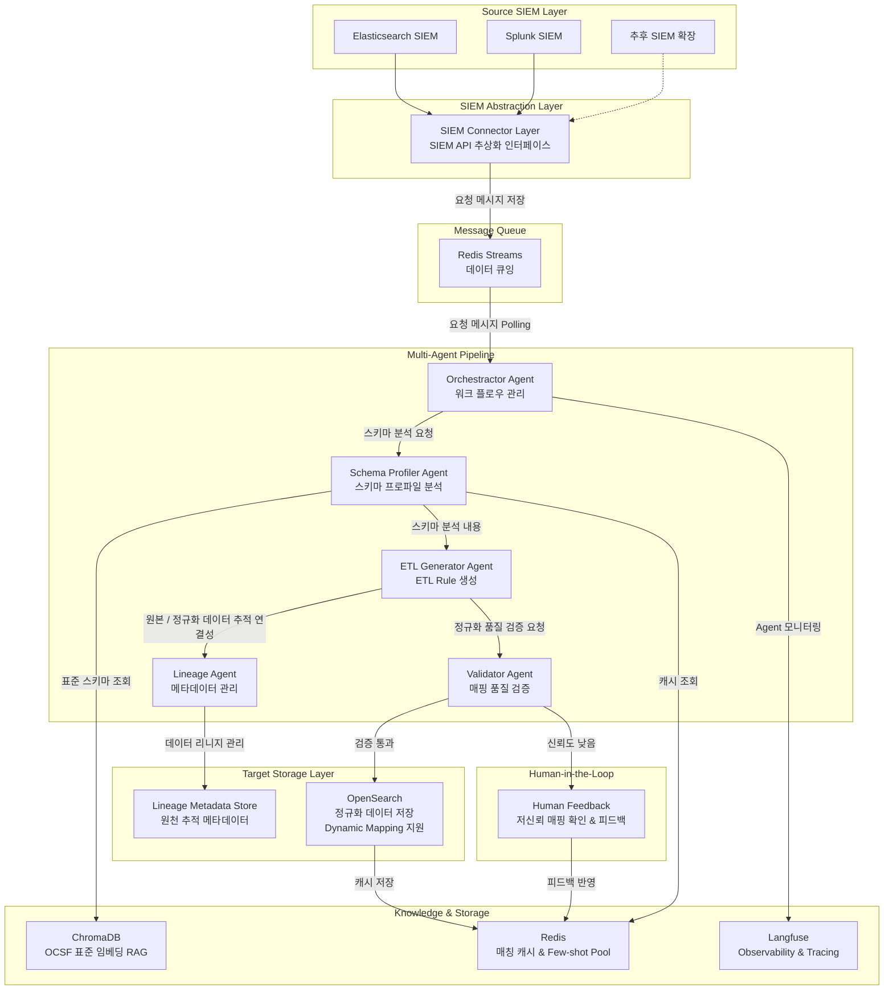

# SCALA-PRD-v1

## 1. 제품명

SCALA

Security Canonical Alignment & Lineage Automation

## 2. 제품 목적

SCALA는 이기종 보안솔루션 데이터를 OCSF 기반 Canonical Schema로 정렬하고, ETL 자동화와 데이터 리니지 추적을 제공하는 Agent 기반 보안 데이터 통합 TUI 시스템이다.

초기 PoC는 Elasticsearch와 Splunk 데이터를 대상으로 한다.

향후 SOAR, Firewall, WAF, EDR, NDR, QRadar, ArcSight, Cloud Security Logs 등 다양한 보안솔루션으로 확장할 수 있어야 한다.

## 3. 현업 문제

보안 데이터는 장비와 솔루션별로 포맷이 다르다.

같은 의미의 필드도 이름이 다를 수 있다.

예시는 다음이다.

- `src_ip`
- `source_ip`
- `client_ip`
- `RemoteAddress`
- `clientip`

타입도 다를 수 있다.

예시는 다음이다.

- `443`
- `"443"`

운영자가 만든 임시 필드, 테스트용 필드, 오탈자 필드, 의미 불명 필드도 섞일 수 있다.

이 때문에 데이터 사이언티스트와 보안 분석가는 매번 수작업으로 필드를 분석하고 전처리해야 한다.

## 4. 제품 목표

SCALA는 다음을 자동화한다.

- Source 연결
- Source field 목록 추출
- Sample data 조회
- Field profiling
- ECS/OCSF 후보 검색
- Canonical Mapping
- Human Review
- ETL Rule 생성
- OpenSearch 적재
- Lineage 저장
- Validator 검증
- Evaluation Agent 평가
- Metrics Report 생성

## 5. 최종 산출물

SCALA 프로젝트의 최종 산출물은 다음 세 가지다.

1. 시연 동영상
2. 실제 코드
3. 산출물 보고서

평가는 영상과 보고서 중심으로 진행될 가능성이 높다.

하지만 코드는 보고서의 주장을 뒷받침할 만큼 실제로 동작해야 한다.

## 6. 제품 범위

### 6.1 PoC 범위

PoC에 포함되는 것은 다음이다.

- Elasticsearch Connector
- Splunk Connector
- OpenSearch Loader
- PostgreSQL Metadata DB
- Redis Streams Job Queue
- ChromaDB OCSF retrieval
- OpenAI Provider
- Langfuse Trace
- Go bubbletea TUI
- FastAPI Backend
- Local Verification Fixtures
- Unit Test

### 6.2 제외 범위

현재 PoC에서 제외하는 것은 다음이다.

- 운영망 배포
- Kubernetes
- Jenkins
- OpenSearch 클러스터링
- 대용량 분산 처리
- 로그인 / OAuth 기능
- Manager UI
- QRadar/ArcSight/SOAR/FW/WAF/EDR 실제 Connector 구현

단, 확장 가능한 Interface는 고려한다.

## 7. Product Agent

SCALA 내부 Product Agent는 다음이다.

| Agent | 역할 | 주요 기능 |
|---|---|---|
| Orchestrator Agent | 전체 workflow 관리 | 작업 분배 및 작업 결과를 사용자와 직접적으로 소통하는 Agent |
| Schema Profiler Agent | 스키마 프로파일 분석 | OCSF 필드 중 매핑 가능한 것 있는 지 판단, 커스텀된 필드인지 판단하는 Agent |
| ETL Generator Agent | ETL Rule 생성 | Data Source 추출, 프로파일 분석 내용 바탕으로 매핑, 정규화 데이터 저장까지 ETL 처리하는 Agent |
| Lineage Agent | 리니지 메타데이터 생성 | 원본 Data Source와 최종 정규화된 데이터 간 추적 연결성 보장을 하는 Agent |
| Validator Agent | 데이터 정합성 검증 | 정규화 처리가 올바른지 판단하는 Agent |

## 8. 주요 워크플로우 

SCALA 구성 요소 및 Agent 간 주요 워크플로우는 다음과 같다. 

## 9. 주요 사용자

### 9.1 평가자

서비스 작업 흐름과 보고서 증빙을 확인한다.

### 9.2 보안 운영자

Source를 등록하고 mapping 결과를 검토한다.

### 9.3 데이터 엔지니어

Canonical Schema, ETL Rule, Lineage를 확인한다.

### 9.4 시스템 관리자

Connector, LLM Provider, Redis, OpenSearch, Langfuse 설정을 관리한다.

현재 PoC에서는 설정 상태 확인을 우선한다. UI에서 설정을 저장하는 기능은 향후 DB 기반 설정 관리 범위로 둔다.

## 10. 주요 화면

SCALA가 직접 구현할 TUI 화면은 다음이다.

- Source Selection
- Field & Sample Explorer
- Mapping Workspace
- Agent Run Monitor
- Human Review
- Result Explorer
- Lineage Viewer
- Settings

Kibana, Splunk Web, OpenSearch Dashboards, Langfuse UI는 외부 웹 화면이다.

## 11. 로컬 검증 데이터 정책

검증 데이터는 실행마다 새로 생성할 수 있어야 한다.

기본 규모는 다음이다.

- Elasticsearch 1000건
- Splunk 1000건
- OpenSearch 적재 결과 2000건

필드 구조와 expected mapping은 유지한다.

값은 랜덤하게 생성하며, 결측치, 오탈자 필드, 커스텀 필드가 포함되어야 한다.

## 12. 평가 지표

정답지가 있는 검증 실행에서 계산하는 지표는 다음이다.

- Field Mapping Precision
- Field Mapping Recall
- Schema Coverage
- Lineage Traceability
- Time Reduction
- Cost Reduction

정답지가 있는 검증 실행용 데이터는 별도로 생성될 수 있어야 하며, 정답지와의 정답, 오답을 판별할 수 있는 지표 계산도 필요하다. 

평가 지표의 경우, 실제 서비스 로직이 아닌 증빙을 위한 자료이므로 실제 서비스와 독립적으로 구성되어야 한다. 

즉, 초기화된 서비스 환경 등 서비스 독립적인 환경에서 해당 서비스의 Agent 수행 결과에 대한 평가 지표 측정이 목적인 것이다. 

## 13. 프로젝트 최종 목표

현재 프로젝트는 MVP, PoC 레벨에서 수행하지만, 간단한 로컬 환경에서는 문제없이 서비스가 되어야 한다. 

즉, CI/CD, Opensearch 클러스터링, 사용자 인증, 권한 관리 등 프로덕션 레벨의 운영 요소를 제외하고, 로컬 개발 환경에서의 기능은 모두 정상적으로 동작해야 한다. 

- ES/Splunk 등 Data source를 선택할 수 있다.
- Field와 sample을 볼 수 있다.
- 실제 OpenAI API를 호출한다.
- Human Review가 동작한다.
- OpenSearch에 취합된 데이터가 적재된다.
- Lineage 조회가 가능하다.
- Langfuse trace를 확인할 수 있다.
- 주요 비즈니스 로직 unit test가 있다.
