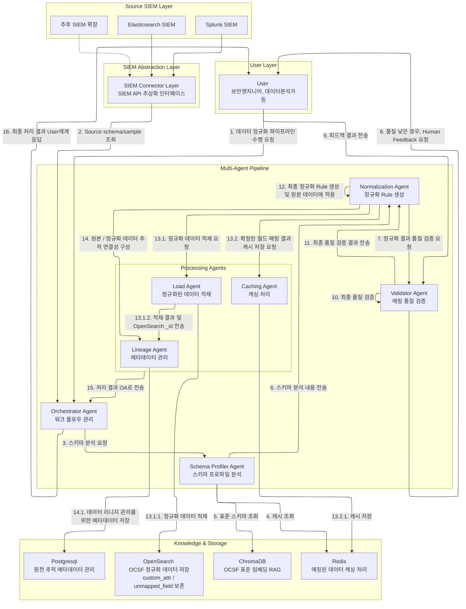

# PRD

## 1. 제품명

SCALA

Security Canonical Alignment & Lineage Automation

## 2. 제품 목적

SCALA는 이기종 보안솔루션 데이터를 OCSF 기반 Canonical Schema로 정렬하고, ETL 자동화와 데이터 리니지 추적을 제공하는 Agent 기반 보안 데이터 통합 TUI 시스템이다.

현재 프로젝트는 Elasticsearch와 Splunk 데이터를 대상으로 한다.

향후 SOAR, Firewall, WAF, EDR, NDR, QRadar, ArcSight, Cloud Security Logs 등 다양한 보안솔루션으로 확장할 수 있어야 한다.

## 3. 현업 문제

보안 데이터는 장비와 솔루션별로 포맷이 다르다.

같은 의미의 필드도 이름이 다를 수 있다.

예시는 다음이다.

- `src_ip`
- `source_ip`
- `client_ip`
- `RemoteAddress`
- `clientip`

타입도 다를 수 있다.

예시는 다음이다.

- `443`
- `"443"`

운영자가 만든 임시 필드, 테스트용 필드, 오탈자 필드, 의미 불명 필드도 섞일 수 있다.

이 때문에 데이터 사이언티스트와 보안 분석가는 매번 수작업으로 필드를 분석하고 전처리해야 한다.

## 4. 제품 목표

SCALA는 다음을 자동화한다.

- Source 연결
- Source field 목록 추출
- Sample data 조회
- Field profiling
- OCSF 후보 검색
- Canonical Mapping
- 정규화 Rule 생성
- OpenSearch 적재
- Lineage 저장
- Validator 검증

그리고 현재 프로젝트 기준, 주요 목표는 다음과 같다. 

- Elasticsearch, Splunk에 저장된 서로 다른 필드의 이름, 타입을 OCSF에 맞는 정규화된 데이터로 취합하여 Opensearch에 적재한다.
- `Scala-Agent`가 판단하기 애매하거나 어려운 것은 `사용자`와 interactive한 소통을 통해 취합할 필드를 확정한다.
- 누락되는 데이터 없이 모든 데이터가 Opensearch에 적재되어야 하며, 모든 적재된 데이터에 대해 원본 데이터와의 Lineage가 가능해야 한다. 
- OCSF 포맷으로 매칭되지 않는 필드의 경우, `custom_attr`, `unmapped_field` 등으로 처리가 되어야 한다. 즉, 모든 필드는 누락이 없어야 한다.
- Data lineage를 위해 원본 source, index, field, id 정보와 정규화 데이터의 `run_id` (작업 실행 id), `원본 데이터의 id 등 식별자`, OpenSearch `_id` 정보를 추적할 수 있어야 한다.
- 토큰 이코노미를 위한 캐시 처리 시, 캐시 저장 대상은 원본 필드와 OCSF 후보/결정 결과의 매핑 정보이다. 예를 들어 `src_ip -> src_endpoint.ip` 같은 source field와 canonical field 간 매핑 결정을 저장한다.

## 5. 제품 범위

### 5.1 프로젝트 범위

현재 프로젝트에 포함되는 것은 다음이다.

- Elasticsearch Connector
- Splunk Connector
- OpenSearch Loader
- Python Backend
- PostgreSQL Metadata DB
- ChromaDB OCSF retrieval
- Redis Cache
- OpenAI Provider
- Go bubbletea TUI
- Local Verification Fixtures
- Unit Test

### 5.2 제외 범위

현재 프로젝트에서 제외하는 것은 다음이다.

- 운영망 배포
- Kubernetes
- Jenkins
- OpenSearch 클러스터링
- 대용량 분산 처리
- 로그인 / OAuth 기능
- Manager UI
- QRadar/ArcSight/SOAR/FW/WAF/EDR 실제 Connector 구현

단, 확장 가능한 Interface는 고려한다.

## 6. Scala-Agents

SCALA 내부 Product Agent(`Scala-Agent`)는 다음이다.

| Agent | 역할 | 주요 기능 |
|---|---|---|
| Orchestrator Agent | 전체 workflow 관리 | 작업 분배 및 작업 결과를 사용자와 직접적으로 소통하는 Agent |
| Schema Profiler Agent | 스키마 프로파일 분석 | OCSF 필드 중 매핑 가능한 것 있는 지 판단, 커스텀된 필드인지 판단하는 Agent. 토큰 이코노미를 위해 캐시 조회도 담당. |
| Normalization Agent | 정규화 Rule 생성 및 적용 | 프로파일 분석 내용과 검증 결과를 바탕으로 필드 매핑 Rule을 생성하고, 원본 데이터에 Rule을 적용하여 정규화 데이터를 생성하는 Agent |
| Validator Agent | 데이터 정합성 검증 | 정규화 처리가 올바른지 판단하는 Agent |
| Lineage Agent | 리니지 메타데이터 생성 | 원본 Data Source와 최종 정규화된 데이터 간 추적 연결성 보장을 하는 Agent |
| Load Agent | 정규화 데이터 적재 | Opensearch sdk, api를 이용하여 정규화된 데이터를 적재하는 Agent |
| Caching Agent | 캐싱 저장 처리 | 정규화 과정에서 확정된 source field와 OCSF field 간 매핑 결과를 Redis Cache에 저장하는 Agent |

## 7. 주요 워크플로우 

SCALA 구성 요소 및 `Scala-Agent` 간 주요 워크플로우는 다음과 같다. 

## 8. 주요 화면

SCALA가 직접 구현할 TUI 화면은 다음이다.

- Main
- Source Selection
- Field & Sample Explorer
- Agent Workflow Graph
- Human Feedback
- Lineage Viewer
- Agent Monitoring
- Settings

Kibana, Splunk Web, OpenSearch Dashboards UI는 외부 웹 화면이며, 원본 데이터, 정규화된 데이터를 확인한다.

## 9. 수동 확인용 랜덤 데이터 정책

수동 확인용 랜덤 데이터는 실행마다 새로 생성할 수 있어야 한다.

기본 규모는 다음이다.

- Elasticsearch 1000건
- Splunk 1000건
- OpenSearch 적재 결과 2000건

elasticsearch와 splunk에 구성되는 필드 이름, 타입은 같을 수도, 다를 수도 있다. 

값은 랜덤하게 생성하며, 결측치, 오탈자 필드, 커스텀 필드가 포함되어야 한다.

## 10. 평가 지표 측정

평가 지표 측정을 위해 정답지가 있는 검증 실행에서 계산하는 지표는 다음이다.

- Field Mapping Precision
- Field Mapping Recall
- Lineage Traceability

정답지가 있는 검증 실행용 데이터는 별도로 생성될 수 있어야 하며, 정답지와의 정답, 오답을 판별할 수 있는 지표 계산도 필요하다. 

평가 지표의 경우, 실제 서비스 로직이 아닌 증빙을 위한 자료이므로 실제 서비스와 독립적으로 구성되어야 한다. 

즉, 초기화된 서비스 환경 등 서비스 독립적인 환경에서 해당 서비스의 Agent 수행 결과에 대한 평가 지표 측정이 목적인 것이다. 

## 11. 현재 프로젝트 최종 목표

현재 프로젝트는 MVP, PoC 레벨에서 수행하지만, 간단한 로컬 환경에서는 문제없이 서비스가 되어야 한다. 

즉, 비정상 종료에 따른 복구 기능, CI/CD, Opensearch 클러스터링, 사용자 인증, 권한 관리 등 프로덕션 레벨의 운영 요소를 제외하고, 로컬 개발 환경에서의 기능은 모두 정상적으로 동작해야 한다. 

- ES/Splunk 등 Data source를 선택할 수 있다.
- Field와 sample을 볼 수 있다.
- 실제 OpenAI API를 호출한다.
- Human Feedback이 동작한다.
- OpenSearch에 취합된 데이터가 적재된다.
- Lineage 조회가 가능하다.
- 주요 비즈니스 로직 unit test가 있다.
